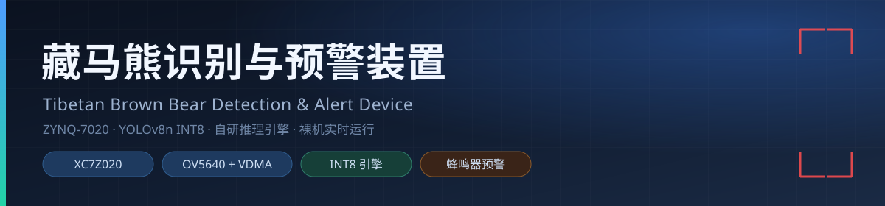
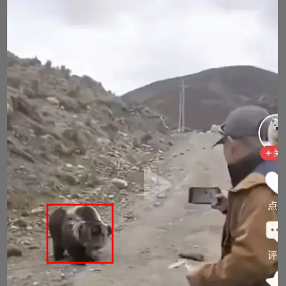
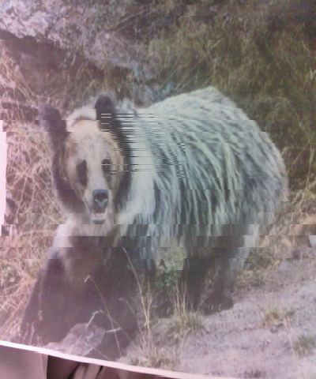
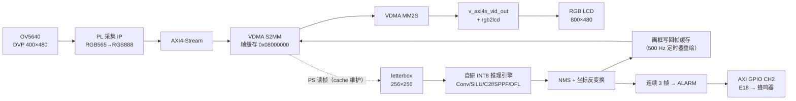

<div align="center">
  
</div>

# 藏马熊识别与预警装置

> 基于 ZYNQ-7020 的**端侧目标检测 + 声光预警**装置：单目 OV5640 采集 → PL 零拷贝显示 → PS 自研 INT8 推理引擎运行 YOLOv8n → 检出即画框并驱动蜂鸣器持续报警。整机**裸机运行**，上电即工作，无需操作系统。

[](https://www.amd.com/en/products/adaptive-socs-and-fpgas/soc/zynq-7000.html)
[](03_模型文件)
[]()
[]()
[](#版权与使用)

---

## 目录

- [它解决什么问题](#它解决什么问题)
- [效果展示](#效果展示)
- [关键指标](#关键指标)
- [系统架构](#系统架构)
- [仓库结构](#仓库结构)
- [快速开始](#快速开始)
- [蜂鸣器报警](#蜂鸣器报警)
- [技术细节](#技术细节)
- [重新构建](#重新构建)
- [测试与验证](#测试与验证)
- [已知限制](#已知限制)
- [文档索引](#文档索引)
- [版权与使用](#版权与使用)

---

## 它解决什么问题

藏马熊（西藏棕熊）活动区域与牧民定居点、放牧路线高度重叠，人熊冲突多发生在**夜间、视野差、无网络**的野外。这类场景里，云端 AI 方案（联网 + 服务器推理）基本失效：没有 4G/5G 信号、没有稳定供电、也没有运维人员。

本装置把整条链路压到一块 ZYNQ 开发板上：

- **看得见**：OV5640 采集画面经 PL 直通 LCD，零拷贝实时预览（无 CPU 刷屏、无撕裂）；
- **认得准**：PS 端跑自研 INT8 推理引擎执行 YOLOv8n 单类模型（藏马熊），与 ONNX Runtime 结果相关系数 **0.999**；
- **报得出**：连续 3 帧确认后触发 `ALARM`，蜂鸣器 2 kHz 持续报警，熊离开画面约 6 s 自动停止；
- **扛得住现场**：纯裸机、无文件系统、无驱动依赖，插电即启动，整机功耗约 3.5 W。

## 效果展示

<p align="center">
  
  
</p>
<p align="center">
  <em>左：装置在板上输出的检测结果（红框为装置绘制）；右：现场用打印照片/手机画面做目标的取景实拍</em>
</p>

更多截图见 [`06_测试数据`](06_测试数据) 与 [`05_文档报告/图片`](05_文档报告/图片)。

## 关键指标

| 项目 | 数值 |
|---|---|
| 主芯片 | ZYNQ-7000 `XC7Z020CLG484-1`（双核 Cortex-A9 @667 MHz + PL） |
| 开发板 | 正点原子 ATK-DF7020-484（V1.1） |
| 图像输入 | OV5640（DVP，RGB565 → RGB888），单路左目 400×480 |
| 显示 | RGB LCD，启动时自动识别 ID（480×272 / 800×480 / 1024×600 / 1280×800） |
| 模型 | YOLOv8n，单类 `zangmaxiong`，3.02 M 参数 |
| 部署精度 | INT8，权重 **3.0 MB**，输入 256×256，1344 anchors，输出 5×1344 |
| 训练精度 | mAP@0.5 = **0.68**，mAP@0.5:0.95 = 0.397，P 0.758 / R 0.652 |
| 一致性 | 与 ONNX Runtime 同图对比 0.892 vs 0.896，逐层相关 > 0.99 |
| 推理速度 | 单帧约 **3.0 s**（纯推理约 2 s，A9 单核标量 + NEON） |
| 判定逻辑 | 置信度 0.28 + NMS IoU 0.45 + 连续 3 帧确认 |
| 报警 | 2 kHz 无源蜂鸣器（PL `E18` / J21 `PL_TX`），持续响，目标消失 6 s 后停 |
| 功耗 | 约 3.5 W（整板含单目摄像头，估算） |

## 系统架构



要点：

1. **预览零拷贝**：显示 VDMA 直接扫描摄像头帧缓存，CPU 不参与整帧搬运，因此画面稳定不闪；
2. **检测与显示解耦**：推理 3 s 一帧，但检测框由 500 Hz 定时器只重画四角短线、只刷局部 cache，既不抢带宽也不会被摄像头 VDMA 覆盖；
3. **SCCB 软件模拟**：PS 通过 EMIO GPIO（EMIO54~57）模拟两路 SCCB，省掉 PL 侧 I2C IP；
4. **像素时钟可配**：`clk_wiz` 按 LCD 分辨率动态重配，一套 bit 支持多种屏。

## 仓库结构

```
zangmaxiong/
├─ 00_先看这里.txt           # U 盘资料索引（现场速览）
├─ 01_程序烧录/              # 可直接上板的产物：BOOT.bin / bear.bit / bear_app.elf / fsbl.elf
├─ 02_工程源码/
│  ├─ src/                  # Vitis 应用源码（main.c、bearnet.c/h、weights.c、驱动）
│  ├─ platform/             # 平台生成脚本（xsct）
│  ├─ pl_buzzer/            # 蜂鸣器 PL 侧改动（Tcl 补丁 + 已实现 bit + 说明）
│  └─ 编译说明.txt
├─ 03_模型文件/              # best.onnx、NCNN INT8 param/bin、weights.bin、windex.h
├─ 04_上位机工具/            # bear_monitor.py：JTAG 读 DDR 帧与日志的 PC 端监视器
├─ 05_文档报告/              # 参赛报告 docx、系统使用说明、测试记录、答辩速查卡、截图
├─ 06_测试数据/              # 板上实测检测结果图
├─ docs/assets/             # README 用图（banner、演示截图）
└─ tools/publish-to-github.ps1  # 一键发布到 GitHub 的脚本
```

## 快速开始

### 方式一：SD 卡启动

1. 把 [`01_程序烧录/BOOT.bin`](01_程序烧录/BOOT.bin) 拷到 **FAT32** SD 卡**根目录**；
2. SD 卡插入开发板，启动模式拨码拨到 **SD**；
3. 上电（或复位），3~5 s 后 LCD 出现左目摄像头实时画面，约 1 s 时有一声 120 ms 蜂鸣器自检音。

> 卡根目录的 `BOOT.bin` 是一个完整启动镜像，内含 `fsbl.elf` + `bear.bit` + `bear_app.elf` 三段。

### 方式二：JTAG 下载

```tcl
connect
targets -set -filter {name =~ "APU*"}
rst -system
fpga -file 01_程序烧录/bear.bit
targets -set -nocase -filter {name =~ "ARM*#0"}
source ps7_init.tcl
ps7_init
ps7_post_config
dow 01_程序烧录/bear_app.elf
con
```

没有 LCD 时，用 [`04_上位机工具/bear_monitor.py`](04_上位机工具/bear_monitor.py) 通过 JTAG 读取板上 DDR 中的标注帧与日志，在 PC 上弹窗查看。

## 蜂鸣器报警

| 蜂鸣器模块（普中 v2） | 接到 |
|---|---|
| VCC | 3.3 V |
| GND | GND |
| BP (BEEP) | J21 跳线排的 **PL_TX** 孔 → FPGA **E18** |

- 模块是**无源**蜂鸣器：输出 2 kHz 方波才响，直流电平静音，**不存在接反有效电平的问题**；
- 上电自检响 120 ms；一旦检出藏马熊**立即**开始持续报警，目标离开画面约 6 s 后自动停止；
- 发声由 **4 kHz 定时器中断**翻 IO 完成，主循环不阻塞，推理期间（约 3 s 一帧）也不会断音；
- PL 侧改动：`axi_gpio_0` 增加通道 2（1 bit 输出），约束 `PACKAGE_PIN E18`，详见 [`02_工程源码/pl_buzzer`](02_工程源码/pl_buzzer)。

## 技术细节

### 自研 INT8 推理引擎（`bearnet.c`）

不依赖 ncnn / OpenCV / 操作系统，只保留本网络需要的算子，纯 C + ARM NEON：

- 算子：`Conv`（3×3 / 1×1，stride 1/2，pad 1）、`SiLU`、`C2f`、`SPPF`（MaxPool 5×5）、nearest `Upsample`、`Concat`、`DFL`（softmax 加权和）、`dist2bbox`、`Sigmoid`、`NMS`；
- 量化：权重逐输出通道对称 INT8 + scale；激活值**逐张量动态**对称量化（运行时统计 amax）；
- 计算：`int8×int8 → int32` 累加，`vmlal_s16` 一次 16 个 MAC，im2col + 分块 GEMM；
- 精度：逐层与 ONNX Runtime 比对，中间张量相关 0.9935~0.9998，最终框坐标相关 0.9994。

### 采集几何修正（一个真实踩坑）

OV5640 默认把 4:3 全阵列压进 5:6 的 400×480 输出窗口，画面纵向被拉伸 1.6 倍，熊看起来又瘦又长。按输出宽高比写入 `0x3800~0x3807` 裁剪窗口（1620×1944 居中）后，**同一帧置信度从 0.078 提升到 0.838**。

### 精度与速度的取舍

| 输入尺寸 | 单帧耗时 | 同图置信度 |
|---|---|---|
| 320×320 | ≈4.0 s | 0.896 |
| **256×256（当前部署）** | **≈3.0 s** | 0.892 |
| 192×192 | ≈2.1 s | 0.890 |

配合 500 Hz 四角框叠加 + 30 fps 去均值 SAD 跟踪，观感上仍是"框跟着熊走"。

> **尺寸口径**：`03_模型文件/best.onnx` 是固定 320×320 输入的导出件，用于 PC 端对照与重新量化；板端引擎是全卷积的，**实际按 256×256 推理**（锚点按特征图尺寸重算，1344 anchors）。文档里出现的 320×320 都指 ONNX 导出尺寸或早期实验，不是当前部署尺寸。

## 重新构建

环境：Vivado / Vitis **2020.2**，Windows，目标 `standalone` / `ps7_cortexa9_0`。

```bash
# 1) 平台（已有 cam_plat 可跳过）
xsct platform/mkplat.tcl

# 2) 应用
xsct platform/build2.tcl

# 3) 打包启动镜像
bootgen -image boot.bif -arch zynq -o BOOT.bin -w on
```

编译选项**必须**设置，否则推理慢 5 倍以上：

```text
-O3  -mfpu=neon -mfloat-abi=hard  -lm
```

`boot.bif` 内容：

```text
the_ROM_image:
{
    [bootloader]fsbl.elf
    bear.bit
    bear_app.elf
}
```

## 测试与验证

| 测试项 | 结果 |
|---|---|
| 双路 OV5640 初始化（SCCB 读 ID） | 成功 |
| 帧缓存刷新（DDR CRC 逐秒变化） | 正常 |
| LCD 识别 | `LCD ID = 0x7084`（7 寸 800×480） |
| 静态图对比（ONNX vs 板上 INT8） | 置信度 0.888 / 0.889，框中心偏差 < 0.3 px |
| 实验场景连续运行 | 1 fps 采样，检出 0，无误报 |
| 目标出现 | 3 帧确认后 `ALARM`，蜂鸣器持续响 |
| 上电自动运行 | 是（无 OS） |

完整记录见 [`05_文档报告/测试记录.md`](05_文档报告/测试记录.md)。

## 已知限制

1. **帧率低**：纯 PS 单核标量推理，256×256 约 3 s/帧；卷积卸载到 PL（HLS `conv2d_stream` IP 已在工程预留）可望到 10 fps 量级；
2. **只认正立目标**：训练集全为正立样本，画面旋转 90° 时置信度只剩 0.10~0.37；
3. **拍屏幕会掉分**：手机屏幕摩尔纹导致置信度在 0.25~0.67 抖动（已用连续 3 帧平均抑制），现场建议用**打印照片**；
4. **LCD 热插拔不重配**：LCD ID 只在启动时读一次，换屏需复位；
5. **单目**：当前只用左目，双目同步不在本版本范围内。

## 文档索引

| 文档 | 内容 |
|---|---|
| [`05_文档报告/系统使用说明.md`](05_文档报告/系统使用说明.md) | 硬件通路、设计细节、常见问题 |
| [`05_文档报告/测试记录.md`](05_文档报告/测试记录.md) | 完整测试数据与调试记录 |
| [`05_文档报告/答辩速查卡.md`](05_文档报告/答辩速查卡.md) | 一页纸：关键数字、亮点、常见追问 |
| [`05_文档报告/蜂鸣器接入说明.md`](05_文档报告/蜂鸣器接入说明.md) | 蜂鸣器接线、PL/PS 改动、排错 |
| [`05_文档报告/藏马熊识别预警装置_参赛报告.docx`](05_文档报告/藏马熊识别预警装置_参赛报告.docx) | 参赛报告全文 |
| [`02_工程源码/编译说明.txt`](02_工程源码/编译说明.txt) | 编译步骤与源码结构 |


## 版权与使用

本项目为参赛作品，**保留所有权利**。仓库公开用于比赛评审、技术交流与学习参考；如需引用代码、模型或图片，请注明出处。商业使用请联系作者。

模型训练数据来源于公开藏马熊影像资料，仅用于科研与赛事演示。
